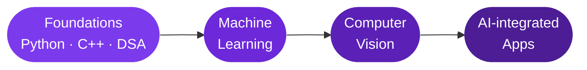

<div align="center">


<br>

<a href="https://www.linkedin.com/in/ishika-jeevtani"></a>
<a href="mailto:ishikajeevtani@gmail.com"></a>

</div>

<br>

```bash
ishika@github:~$ neofetch

┌──────────────────────────────────────┐
│ USER      Ishika Jeevtani            │
│ STUDYING  B.Tech CSE, 2nd year, RJIT │
│ BASE      Gwalior, India             │
│ FOCUS     AI apps · Computer Vision  │
│ STACK     Python · C++ · Java        │
└──────────────────────────────────────┘
```

## The Path



## Loading...

```text
Python             ████████████░░░░░░░░  60%
C++                ██████████░░░░░░░░░░  50%
DSA                ████████░░░░░░░░░░░░  40%
Machine Learning   ████░░░░░░░░░░░░░░░░  20%
Computer Vision    ██░░░░░░░░░░░░░░░░░░  10%
```

## Projects

<details>
<summary><b>🤝 VolunteerIQ</b></summary>
<br>

AI-powered volunteer coordination platform.

`AI` `Web app`

[Live demo ↗](https://volunteeriq.vercel.app) · [Code ↗](https://github.com/ishikajeevtani/volunteeriq)

</details>

<details>
<summary><b>📁 FileForge</b></summary>
<br>

File manager with full create, read, update and delete, wrapped in a Streamlit UI.

`Python` `Streamlit`

[Code ↗](https://github.com/ishikajeevtani/fileforge-streamlit)

</details>

<details>
<summary><b>🧩 DSA Journey</b></summary>
<br>

Data structures and algorithms practice in C++.

`C++` `DSA`

[Code ↗](https://github.com/ishikajeevtani/dsa-journey)

</details>

<details>
<summary><b>⚙️ C++ Fundamentals</b></summary>
<br>

Core C++ concepts with practice programs.

`C++`

[Code ↗](https://github.com/ishikajeevtani/cpp-fundamentals)

</details>

<details>
<summary><b>📒 Class Register</b></summary>
<br>

Python app for managing class records.

`Python`

[Code ↗](https://github.com/ishikajeevtani/class-register)

</details>

<details>
<summary><b>🐍 Python Fundamentals</b></summary>
<br>

Python basics and practice programs.

`Python`

[Code ↗](https://github.com/ishikajeevtani/NYC-python)

</details>

## Toolbox

<p align="center">
  
</p>

<details>
<summary><b>📊 GitHub stats</b></summary>
<br>
<p align="center">
  
  
</p>
</details>


